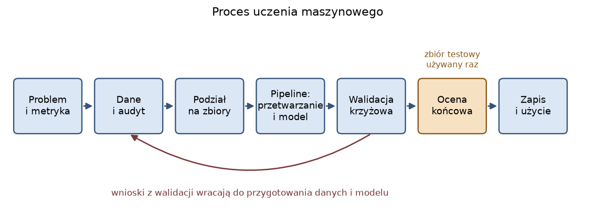
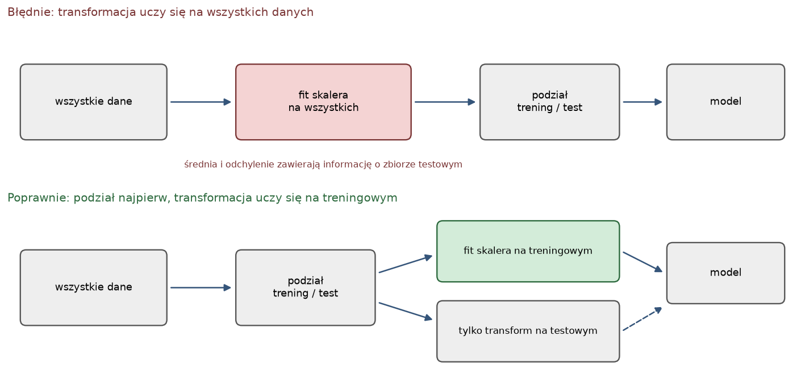
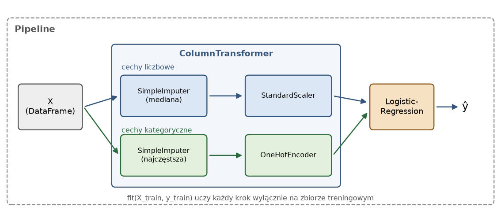

# Laboratorium 1: wprowadzenie

Ten dokument zbiera pojęcia, które pojawiają się w zadaniach. Czytaj go przed zajęciami, a w trakcie wracaj do fragmentów, których akurat potrzebujesz.

## Proces uczenia maszynowego

Zbudowanie modelu to tylko jeden z kilku kroków i zwykle nie najdłuższy. Pracę zaczyna sformułowanie problemu w sposób, który da się zmierzyć: co dokładnie przewidujemy, dla kogo, jaką metryką ocenimy wynik i ile kosztuje każdy rodzaj pomyłki. Potem następuje audyt danych, podział na zbiory, zbudowanie pipeline'u z przetwarzaniem i modelem, walidacja krzyżowa wariantów, jednorazowa ocena końcowa i zapis gotowego rozwiązania.



Strzałka wstecz na rysunku oznacza, że wyniki walidacji prowadzą do zmian w danych i modelu. Zbiór testowy stoi poza tą pętlą. Jeśli zaczniesz na nim wybierać między wariantami, przestaje być niezależną oceną i zaczyna być jeszcze jednym zbiorem walidacyjnym.

## Sformułowanie problemu

Zbiór Adult (rekordy spisowe z 1994 roku, 48842 osoby) opisuje dorosłych 14 cechami, a zmienną docelową jest informacja, czy roczny dochód przekracza 50 tys. USD. To klasyfikacja binarna. Dobra notatka o problemie zawiera sześć elementów: cel biznesowy, zmienną docelową, jednostkę obserwacji, metrykę sukcesu, koszty błędów i baseline, czyli wynik najprostszego rozsądnego rozwiązania, do którego porównujemy model. Dla klasyfikacji baseline to zwykle klasyfikator zawsze wskazujący klasę większościową (w scikit-learn `DummyClassifier`).

## Dane i ich audyt

Zanim cokolwiek zbudujesz, sprawdź rozmiar, typy kolumn, braki, rozkład zmiennej docelowej i duplikaty. Z braków wynika decyzja o imputacji (uzupełnianiu). Rozróżnia się braki losowe (MCAR, brak nie zależy od niczego), losowe warunkowo (MAR, zależy od innych zmiennych) i nielosowe (MNAR, zależy od samej brakującej wartości). W praktyce rzadko wiemy, który przypadek mamy, ale warto sprawdzić, czy sam fakt braku jest związany z celem, bo wtedy usunięcie wierszy z brakami lub zastąpienie ich dominantą zniekształca dane.

W audycie szukamy też cech podejrzanych: prawie unikalnych identyfikatorów, kolumn, które powtarzają tę samą informację w dwóch zapisach, zmiennych niedostępnych w chwili predykcji oraz zmiennych wrażliwych (płeć, rasa), których użycie wymaga osobnej decyzji.

## Podział danych i wyciek informacji

Zbiór dzielimy na treningowy i testowy zanim cokolwiek dopasujemy do danych. Przy niezbalansowanych klasach używamy podziału stratyfikowanego (`stratify=y`), który zachowuje udział klas w obu częściach.

Wyciek informacji (data leakage) to sytuacja, w której do procesu uczenia lub do cech trafia informacja, której nie będzie w chwili prawdziwej predykcji. Ma dwie odmiany. Pierwsza to cecha, która zawiera zakodowaną odpowiedź (np. pole wyliczone z dochodu). Daje ona nierealistycznie wysoką dokładność i wynik nie mówi nic o jakości modelu. Druga jest mniej widoczna: transformacja (skaler, imputer, enkoder, selekcja cech) dopasowana na całym zbiorze, czyli także na wierszach testowych. Średnia i odchylenie obliczone na wszystkich danych niosą informację o zbiorze testowym.



Reguła jest jedna: każdy krok, który uczy się z danych, uczy się wyłącznie na zbiorze treningowym (a w walidacji krzyżowej wyłącznie na treningowej części foldu). Do przekształcania zbioru testowego używamy `transform`, nigdy `fit` ani `fit_transform`.

## Przetwarzanie cech

Cechy liczbowe z lukami uzupełniamy imputerem (`SimpleImputer` z medianą, bardziej odporną na wartości skrajne niż średnia), a następnie skalujemy. Skalowanie standaryzujące (`StandardScaler`) przesuwa każdą cechę do średniej 0 i odchylenia 1. Modele wrażliwe na skalę cech (regresja logistyczna, kNN, SVM, sieci neuronowe) go potrzebują, bo różnice rzędu wielkości (capital-gain sięga 99999, education-num 16) zaburzają optymalizację. Drzewa decyzyjne korzystają wyłącznie z kolejności wartości, więc skalowanie ich nie zmienia.

Cechy kategoryczne uzupełniamy najczęstszą wartością lub stałą, a potem kodujemy. `OneHotEncoder` zamienia każdą kategorię na osobną kolumnę 0/1. Ustawienie `handle_unknown="ignore"` sprawia, że kategoria, której model nie widział w treningu, jest kodowana samymi zerami zamiast powodować błąd. Parametr `min_frequency` łączy kategorie rzadsze niż podany próg w jedną grupę, co ogranicza liczbę kolumn i szum wokół rzadkich poziomów.

## Pipeline i ColumnTransformer

`ColumnTransformer` stosuje różne przekształcenia do różnych kolumn, a `Pipeline` łączy kolejne kroki w jeden obiekt, który ma metody `fit` i `predict`. Dzięki temu całe przetwarzanie dopasowuje się razem z modelem i tylko na tych danych, które do `fit` podamy. To najprostsza ochrona przed wyciekiem, bo walidacja krzyżowa wywołana na pipeline'ie dopasowuje wszystko od nowa w każdym foldzie.



Przykład preprocessora z rysunku:

```python
num_pipe = Pipeline([
    ("imputer", SimpleImputer(strategy="median")),
    ("scaler", StandardScaler()),
])
cat_pipe = Pipeline([
    ("imputer", SimpleImputer(strategy="most_frequent")),
    ("onehot", OneHotEncoder(handle_unknown="ignore", min_frequency=50)),
])
preprocessor = ColumnTransformer([
    ("num", num_pipe, num_cols),
    ("cat", cat_pipe, cat_cols),
])
pipe = Pipeline([("prep", preprocessor), ("model", LogisticRegression(max_iter=1000))])
```

Nazwy cech po przetworzeniu odczytasz przez `pipe[:-1].get_feature_names_out()`.

## Metryki przy niezbalansowanych klasach

W Adult klasa wyższych dochodów to 23,9% rekordów, więc klasyfikator zawsze odpowiadający `<=50K` ma accuracy 0,761. Samo accuracy nie odróżnia więc modelu, który się czegoś nauczył, od takiego, który ignoruje mniejszą klasę. Pomagają metryki, które na to reagują:

```
balanced accuracy = średnia z czułości obu klas (baseline = 0,5)
F1                = średnia harmoniczna precyzji i czułości klasy pozytywnej
ROC AUC           = prawdopodobieństwo, że losowa osoba z klasy >50K dostaje wyższy wynik niż losowa z <=50K
```

ROC AUC nie zależy od progu decyzyjnego i ocenia samo uszeregowanie, a balanced accuracy i F1 dotyczą konkretnej decyzji przy progu (domyślnie 0,5). Przy walidacji krzyżowej raportuje się średnią i odchylenie standardowe z foldów: różnice mniejsze niż odchylenie trzeba traktować jak szum.

## Zapis modelu

Do zapisu całego dopasowanego pipeline'u (nie samego modelu) służy `joblib.dump`, a do odczytu `joblib.load`. Plik jest związany z wersją scikit-learn, w której powstał, więc warto zapisać numer wersji obok. Otwieraj tylko pliki z zaufanych źródeł, bo wczytanie obiektu serializowanego może wykonać dowolny kod.

## Literatura i dokumentacja

- scikit-learn, Pipelines and composite estimators: https://scikit-learn.org/stable/modules/compose.html
- scikit-learn, Common pitfalls and recommended practices (wyciek danych): https://scikit-learn.org/stable/common_pitfalls.html
- scikit-learn, Preprocessing data: https://scikit-learn.org/stable/modules/preprocessing.html
- scikit-learn, Imputation of missing values: https://scikit-learn.org/stable/modules/impute.html
- scikit-learn, Cross-validation: https://scikit-learn.org/stable/modules/cross_validation.html
- scikit-learn, Metrics and scoring: https://scikit-learn.org/stable/modules/model_evaluation.html
- scikit-learn, Model persistence: https://scikit-learn.org/stable/model_persistence.html
- A. Géron, Hands-On Machine Learning with Scikit-Learn, Keras and TensorFlow, rozdział 2 (projekt uczenia maszynowego od początku do końca) i rozdział o klasyfikacji (miary jakości).
