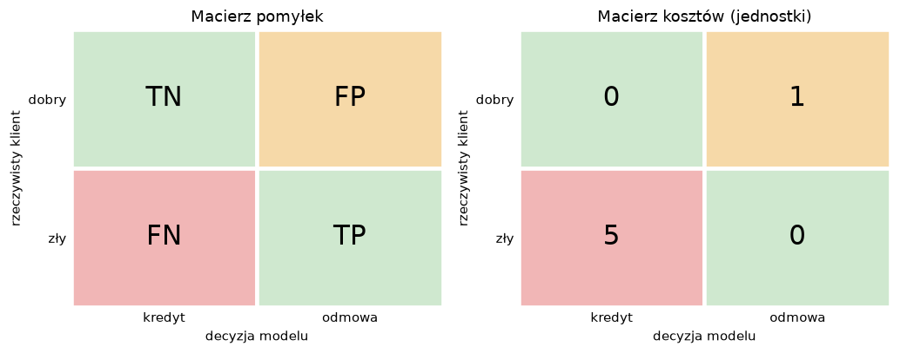
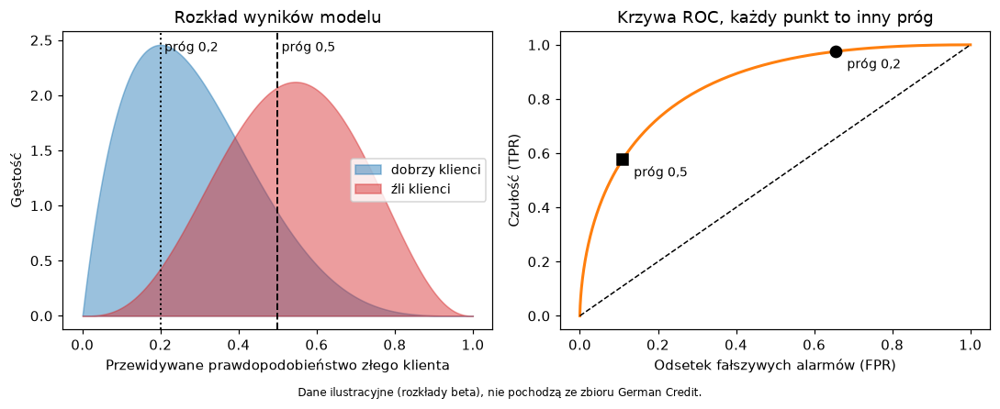
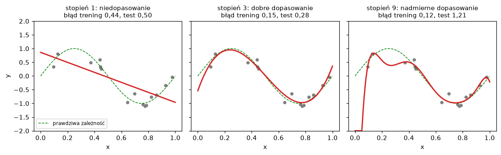

# Laboratorium 2: wprowadzenie

## Zadanie klasyfikacji

Klasyfikator przypisuje obiektowi jedną z ustalonych klas na podstawie jego cech. W tym laboratorium pracujemy ze zbiorem German Credit: 1000 klientów banku opisanych 20 cechami (czas kredytu, kwota, wiek, stan konta, cel kredytu i inne), a pytanie brzmi, czy klient kredyt spłaci. Zbiór pochodzi z repozytorium UCI (Statlog German Credit Data, 1994), a wersja z OpenML (`credit-g`) zawiera 700 klientów dobrych i 300 złych.

W klasyfikacji binarnej jedną z klas umownie nazywamy pozytywną. Zwykle jest to ta, którą chcemy wykrywać, więc tutaj pozytywny jest klient zły (kredyt niespłacony), zakodowany jako 1. Większość modeli oprócz samej klasy zwraca też wynik z przedziału od 0 do 1 (w scikit-learn metoda `predict_proba`), a klasę wybiera się przez porównanie tego wyniku z progiem. Domyślny próg 0,5 jest tylko konwencją i nie ma żadnego uzasadnienia biznesowego.

## Macierz pomyłek i metryki

Wszystkie podstawowe metryki wynikają z czterech liczb: prawdziwie pozytywnych (TP), prawdziwie negatywnych (TN), fałszywie pozytywnych (FP, fałszywy alarm) i fałszywie negatywnych (FN, przeoczenie).



```
accuracy  = (TP + TN) / (TP + TN + FP + FN)
precision = TP / (TP + FP)        # ilu z ogłoszonych złych klientów to rzeczywiście źli
recall    = TP / (TP + FN)        # ilu złych klientów udało się wykryć (czułość)
F1        = 2 * precision * recall / (precision + recall)
FPR       = FP / (FP + TN)        # odsetek dobrych klientów uznanych za złych
```

Accuracy bywa zwodnicza, gdy klasy mają różne liczności. W naszym zbiorze klasyfikator, który zawsze przyznaje kredyt, ma accuracy równe 0,70, mimo że nie wykrywa żadnego złego klienta. Dlatego każdy model porównujemy z takim klasyfikatorem odniesienia (baseline), a obok accuracy patrzymy na precision, recall, F1 i na balanced accuracy, czyli średnią z recall obu klas.

## Metryki niezależne od progu

Zmieniając próg, przesuwamy model po krzywej, na której wymieniamy fałszywe alarmy na przeoczenia. Krzywa ROC pokazuje czułość (recall) w funkcji odsetka fałszywych alarmów (FPR) dla wszystkich możliwych progów. Pole pod nią (AUC) ma prostą interpretację: jest to prawdopodobieństwo, że losowo wybrany zły klient dostanie od modelu wyższy wynik niż losowo wybrany dobry. Wartość 0,5 oznacza losowy ranking, 1,0 ranking idealny.



Krzywa precision-recall pokazuje precision w funkcji recall. Jej poziom bazowy to udział klasy pozytywnej (tu 0,30), a nie przekątna, więc przy niezbalansowanych klasach różnice między modelami widać na niej wyraźniej niż na krzywej ROC. Pole pod nią podaje się jako średnią precyzję (average precision).

## Próg decyzyjny i koszt

Błędy nie muszą kosztować tyle samo. Opis zbioru German Credit w OpenML, odsyłający do oryginału w UCI, zawiera macierz kosztów: przyznanie kredytu złemu klientowi kosztuje 5 jednostek, odmowa dobremu klientowi 1 jednostkę, trafne decyzje nic. Koszt całkowity to więc `1 * FP + 5 * FN`, a koszt na klienta dzielimy przez liczbę klientów.

Jeśli wynik modelu jest dobrze skalibrowanym prawdopodobieństwem p złego klienta, to odmowa opłaca się, gdy `5 * p > 1 * (1 - p)`, czyli gdy p przekracza 1/6, około 0,167. W praktyce prawdopodobieństwa modeli rzadko są idealnie skalibrowane, więc próg wyznacza się empirycznie: liczy się koszt na predykcjach z walidacji krzyżowej dla siatki progów i wybiera minimum. Podobny efekt można uzyskać, nadając klasom wagi (`class_weight`) już na etapie uczenia, choć wtedy próg zostaje blisko 0,5 i trudniej o pełną kontrolę.

## Rzetelna ocena

Dane dzielimy na zbiór treningowy i testowy, z zachowaniem proporcji klas (podział stratyfikowany). Wybór modelu, hiperparametrów i progu odbywa się wyłącznie na zbiorze treningowym, przez walidację krzyżową, w której każdy fragment danych pełni po kolei rolę walidacyjną. Powtórzona walidacja krzyżowa (`RepeatedStratifiedKFold`) daje wiele wyników dla każdego modelu, więc można podać średnią i odchylenie standardowe, a nie pojedynczą liczbę. Funkcja `cross_val_predict` zwraca dla każdego przykładu predykcję modelu, który tego przykładu nie widział, co pozwala budować macierze pomyłek i krzywe na całym zbiorze treningowym.

Zbiór testowy służy do jednej oceny końcowej wybranego modelu. Jeżeli wynik testowy skłoni do zmiany modelu lub progu, test przestaje być niezależny i trzeba by wydzielić nowy. Wszystkie kroki przygotowania danych (skalowanie, kodowanie) umieszczamy w `Pipeline`, żeby w każdym podziale były dopasowywane tylko do części treningowej.

## Niedopasowanie i nadmierne dopasowanie

Model zbyt prosty nie oddaje zależności w danych (niedostateczne dopasowanie, wysokie obciążenie), a model zbyt elastyczny dopasowuje się do szumu zbioru treningowego (nadmierne dopasowanie, wysoka wariancja).



Diagnozuje się to dwoma wykresami. Krzywa uczenia (`learning_curve`) pokazuje wynik treningowy i walidacyjny w funkcji liczby przykładów: gdy oba są niskie i zbliżone, model jest za prosty, a gdy wynik treningowy jest wysoki i dużo lepszy od walidacyjnego, mamy nadmierne dopasowanie. Krzywa walidacyjna (`validation_curve`) pokazuje te same wyniki w funkcji jednego hiperparametru, na przykład głębokości drzewa albo siły regularyzacji C w regresji logistycznej. Optimum leży tam, gdzie wynik walidacyjny jest najwyższy, a nie tam, gdzie wynik treningowy.

## Literatura i dokumentacja

- Dokumentacja scikit-learn, metryki i ocena modeli: https://scikit-learn.org/stable/modules/model_evaluation.html
- Dokumentacja scikit-learn, walidacja krzyżowa: https://scikit-learn.org/stable/modules/cross_validation.html
- Dokumentacja scikit-learn, krzywe uczenia i walidacyjne: https://scikit-learn.org/stable/modules/learning_curve.html
- Dokumentacja scikit-learn, strojenie progu decyzyjnego: https://scikit-learn.org/stable/modules/classification_threshold.html
- Przykład scikit-learn: wrażliwość na koszty i wybór progu: https://scikit-learn.org/stable/auto_examples/model_selection/plot_cost_sensitive_learning.html
- Opis zbioru German Credit w UCI: https://archive.ics.uci.edu/ml/datasets/statlog+(german+credit+data)
- A. Géron, Hands-On Machine Learning with Scikit-Learn, Keras and TensorFlow, rozdział o klasyfikacji (miary jakości, macierz pomyłek, krzywe ROC i PR).
