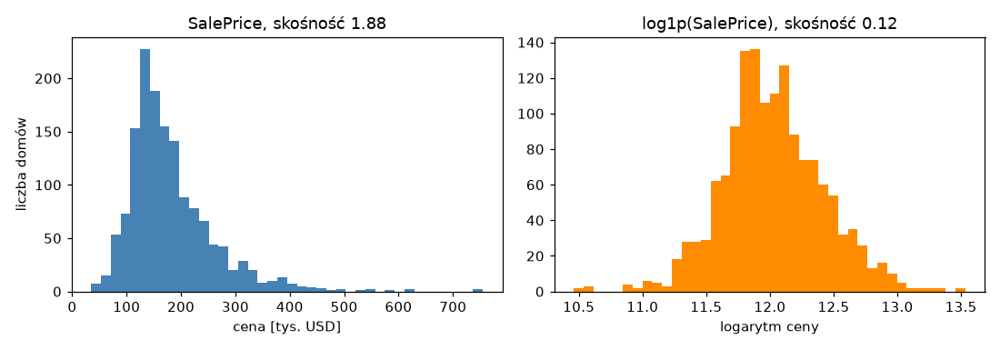
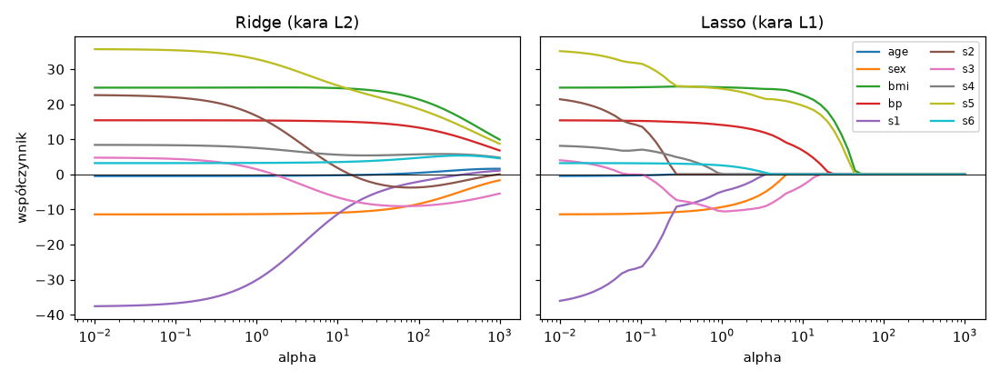
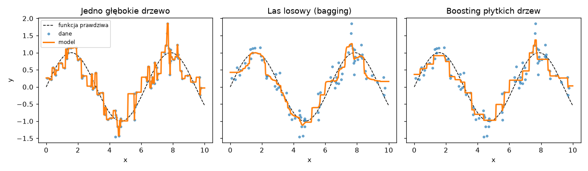

# Laboratorium 3: Regresja, modele zespołowe, strojenie, interpretacja

## Wprowadzenie

Regresja polega na przewidywaniu liczby, a nie klasy. W tym laboratorium celem jest cena sprzedaży domu w mieście Ames (stan Iowa), a danych dostarcza zbiór Ames Housing: 1460 transakcji opisanych 79 cechami (powierzchnia, jakość wykończenia, dzielnica, rok budowy, garaż, piwnica i wiele innych). Zbiór jest niewielki, ale ma wszystkie kłopoty typowe dla danych z praktyki: cechy liczbowe i kategoryczne, kategorie uporządkowane, mnóstwo braków, skośny rozkład celu i kilka obserwacji, które wyglądają na błędy, choć nimi nie są. Pipeline, podział na zbiór treningowy i testowy oraz walidacja krzyżowa są znane z poprzednich zajęć i będą stosowane bez przypominania.

## Zmienna docelowa i metryki

Ceny domów mają rozkład prawoskośny: większość transakcji mieści się w wąskim przedziale, a nieliczne domy kosztują kilka razy więcej od mediany. Taki rozkład źle współpracuje z modelami liniowymi, bo kilka drogich obserwacji ma nieproporcjonalny wpływ na dopasowanie. Typowym rozwiązaniem jest uczenie modelu na logarytmie ceny i przekształcanie predykcji z powrotem przez funkcję odwrotną. W scikit-learn robi to `TransformedTargetRegressor`, który razem z logarytmem `log1p` i funkcją odwrotną `expm1` można opakować wokół całego pipeline'u, dzięki czemu metryki liczy się w oryginalnych jednostkach.



Wybór metryki zależy od tego, co kosztuje użytkownika modelu. Wszystkie poniższe są liczone na predykcjach `y_pred` i wartościach rzeczywistych `y`:

```
MAE   = średnia z |y - y_pred|                  typowy błąd w dolarach
RMSE  = sqrt(średnia z (y - y_pred)^2)          silnie karze duże błędy
R2    = 1 - suma kwadratów błędów / suma kwadratów odchyleń od średniej
RMSLE = sqrt(średnia z (log(1+y) - log(1+y_pred))^2)   błąd względny
```

RMSLE mierzy błąd względny, więc pomyłka o 20 tys. USD przy domu za 80 tys. liczy się znacznie bardziej niż przy domu za 500 tys. Wymaga przy tym nieujemnych predykcji (logarytm), co dla modelu liniowego uczonego na surowej cenie nie jest gwarantowane. RMSE i R2 są natomiast bardzo wrażliwe na pojedyncze skrajne obserwacje, o czym laboratorium pokaże konkretny przykład.

## Semantyka braków

W zbiorze Ames wiele wartości `NaN` nie oznacza utraty informacji. Brak w kolumnie `PoolQC` mówi, że dom nie ma basenu, brak w `GarageType`, że nie ma garażu, brak w `BsmtQual`, że nie ma piwnicy. Takie pole nie powinno być uzupełniane najczęstszą wartością, bo to zatarłoby różnicę między domem z basenem a domem bez niego. Dla kolumn opisowych odpowiednia jest osobna kategoria `brak` (w kategoriach porządkowych jest to najniższy poziom skali). Prawdziwe braki informacji dotyczą kilku kolumn (na przykład `LotFrontage`, `MasVnrType`, `Electrical`) i tam stosuje się zwykłą imputację, w razie potrzeby z dodatkowym wskaźnikiem braku. Przed przetwarzaniem warto więc sprawdzić, co dany brak znaczy, na przykład porównując go z kolumną liczbową (brak w `PoolQC` powinien zbiegać się z `PoolArea` równym zero).

## Regularyzacja w modelach liniowych

Zwykła regresja liniowa (`LinearRegression`) przy kilkuset cechach, z których wiele jest skorelowanych, daje niestabilne współczynniki i nadmiernie dopasowuje się do zbioru treningowego. Regularyzacja dodaje do funkcji straty karę za wielkość współczynników:

```
Ridge:       strata + alpha * suma kwadratów współczynników   (kara L2)
Lasso:       strata + alpha * suma modułów współczynników     (kara L1)
ElasticNet:  mieszanka obu, proporcję określa l1_ratio
```

Parametr `alpha` jest hiperparametrem: im większy, tym silniejsze skrócenie współczynników i tym prostszy model. Kara L2 zmniejsza współczynniki w sposób ciągły, ale nie sprowadza ich do zera. Kara L1 potrafi je wyzerować, więc Lasso jednocześnie dopasowuje model i wybiera cechy. Obie kary zakładają, że cechy mają porównywalną skalę, dlatego w pipeline cechy liczbowe są standaryzowane. Wykres poniżej pokazuje ścieżki współczynników dla małego zbioru `diabetes` z biblioteki scikit-learn: przy rosnącym `alpha` współczynniki Ridge maleją płynnie, a w Lasso kolejne cechy znikają jedna po drugiej.



## Modele zespołowe: bagging i boosting

Pojedyncze głębokie drzewo decyzyjne dopasowuje się do danych niemal idealnie, ale jego predykcje są niestabilne: niewielka zmiana zbioru treningowego daje inne drzewo (duża wariancja). Modele zespołowe łączą wiele drzew na dwa sposoby.

W baggingu drzewa uczone są niezależnie na losowych próbkach bootstrapowych, a ich predykcje uśrednia się. Las losowy (`RandomForestRegressor`) dodatkowo losuje podzbiór cech przy każdym podziale (parametr `max_features`), co zmniejsza korelację między drzewami. Uśrednianie redukuje wariancję, więc więcej drzew praktycznie nie szkodzi, a jedynie wydłuża obliczenia. Odmianą z jeszcze większą losowością jest `ExtraTreesRegressor`.

W boostingu drzewa, zwykle płytkie, uczone są po kolei: każde następne poprawia błędy (reszty) zespołu zbudowanego dotąd. Zmniejsza to błąd systematyczny (obciążenie), ale zbyt wiele iteracji prowadzi do nadmiernego dopasowania, więc liczba iteracji i tempo uczenia (`learning_rate`) muszą być dobrane razem. W laboratorium używany jest `HistGradientBoostingRegressor`, który grupuje wartości cech w przedziały (histogramy) i dzięki temu działa szybko na większych danych. Podobne działanie mają popularne biblioteki XGBoost i LightGBM.



Drzewa mają jeszcze jedną ważną własność: nie ekstrapolują. Dla obserwacji spoza zakresu danych treningowych zwracają wartość z najbliższego liścia, podczas gdy model liniowy przedłuża prostą, co w skali logarytmicznej bywa katastrofalne. Ta różnica stanie się widoczna przy analizie największych błędów.

## Strojenie hiperparametrów

Hiperparametry (takie jak `alpha`, `max_leaf_nodes` czy `learning_rate`) nie są uczone z danych i trzeba je wybrać. `GridSearchCV` sprawdza wszystkie kombinacje z zadanej siatki, co przy kilku parametrach szybko robi się kosztowne. `RandomizedSearchCV` losuje zadaną liczbę kombinacji z rozkładów (na przykład `loguniform` dla tempa uczenia), więc budżet obliczeń jest ustalony z góry i dobrze pokrywa wszystkie osie. Obie metody oceniają kandydatów walidacją krzyżową na zbiorze treningowym. Zbiór testowy nie bierze udziału w strojeniu. Wynik najlepszego kandydata jest zresztą nieco optymistyczny, bo został wybrany spośród wielu na tych samych foldach, dlatego uczciwą ocenę daje dopiero odłożony test.

## Interpretacja modelu

Model dokładny, ale niezrozumiały trudno sprawdzić i trudno mu zaufać, dlatego po wytrenowaniu warto zobaczyć, na czym się opiera. Ważność permutacyjna (`permutation_importance`) tasuje wartości jednej cechy w zbiorze testowym i mierzy, o ile pogarsza się jakość predykcji: duży spadek oznacza, że model silnie korzysta z tej cechy. Metoda mierzy użyteczność cechy dla modelu, a nie związek przyczynowy, a przy cechach silnie skorelowanych dzieli ważność między nie.

Wykresy zależności cząstkowej (PDP, od partial dependence plot) pokazują średni wpływ jednej cechy na predykcję przy ustalonych pozostałych, a linie ICE (individual conditional expectation) robią to dla pojedynczych obserwacji, więc ujawniają różnice między nimi. Wreszcie analiza reszt i największych błędów odpowiada na pytanie, gdzie model się myli i czy da się to wyjaśnić cechami domu. Taka analiza jest często ważniejsza niż trzecia cyfra po przecinku w metryce.

## Literatura i dokumentacja

- scikit-learn, modele liniowe (Ridge, Lasso, ElasticNet): https://scikit-learn.org/stable/modules/linear_model.html
- scikit-learn, metody zespołowe (las losowy, gradient boosting): https://scikit-learn.org/stable/modules/ensemble.html
- scikit-learn, strojenie hiperparametrów: https://scikit-learn.org/stable/modules/grid_search.html
- scikit-learn, metryki regresji: https://scikit-learn.org/stable/modules/model_evaluation.html
- scikit-learn, transformacja celu i ColumnTransformer: https://scikit-learn.org/stable/modules/compose.html
- scikit-learn, ważność permutacyjna: https://scikit-learn.org/stable/modules/permutation_importance.html
- scikit-learn, wykresy zależności cząstkowej: https://scikit-learn.org/stable/modules/partial_dependence.html
- D. De Cock, Ames, Iowa: Alternative to the Boston Housing Data as an End of Semester Regression Project, Journal of Statistics Education 19(3), 2011 (opis zbioru): https://jse.amstat.org/v19n3/decock.pdf
- G. James, D. Witten, T. Hastie, R. Tibshirani, An Introduction to Statistical Learning, rozdziały 6 (regularyzacja) i 8 (metody drzewiaste): https://www.statlearning.com
