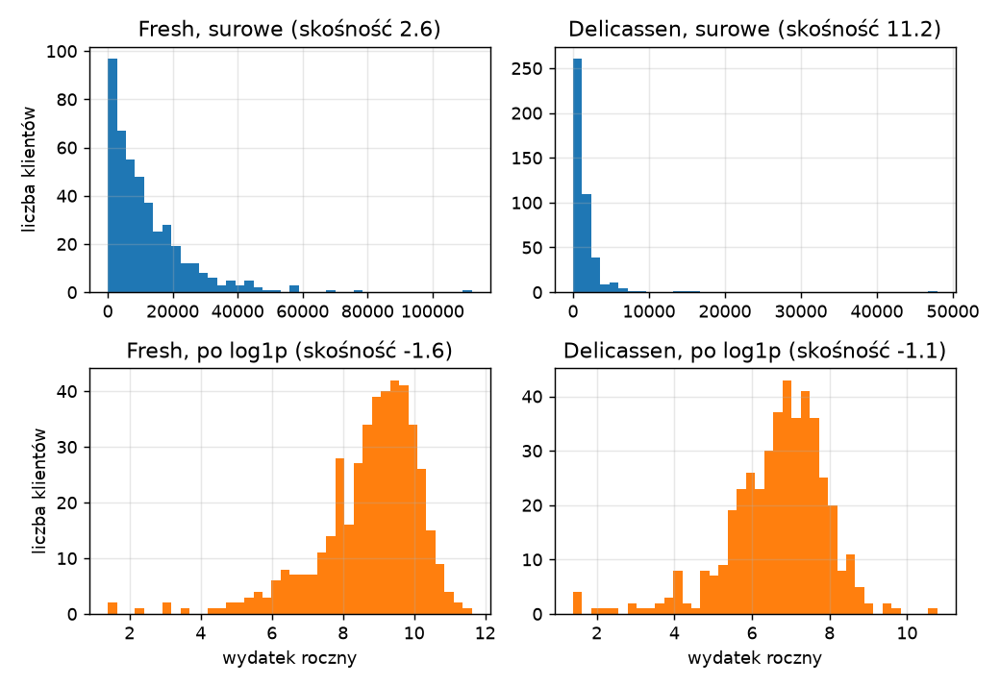
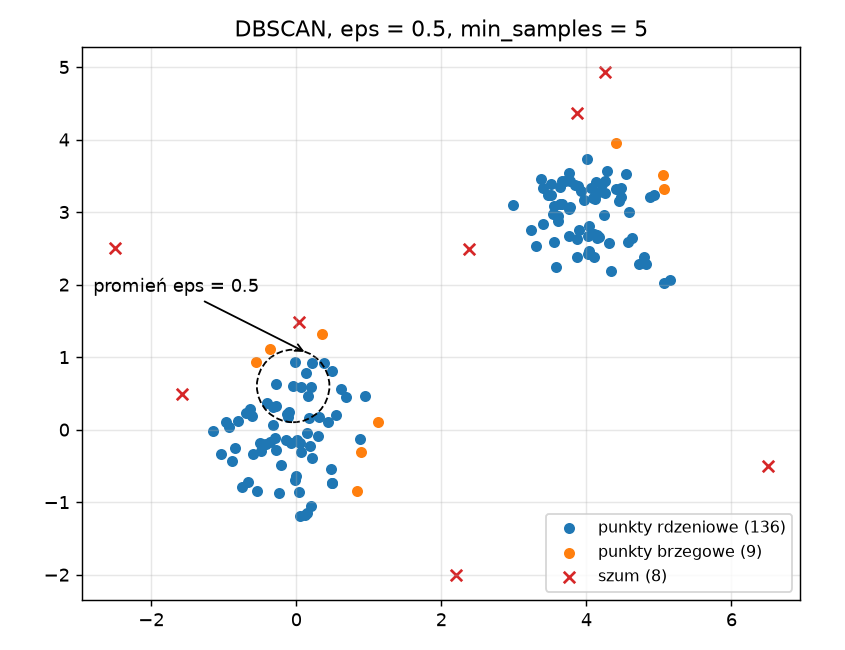
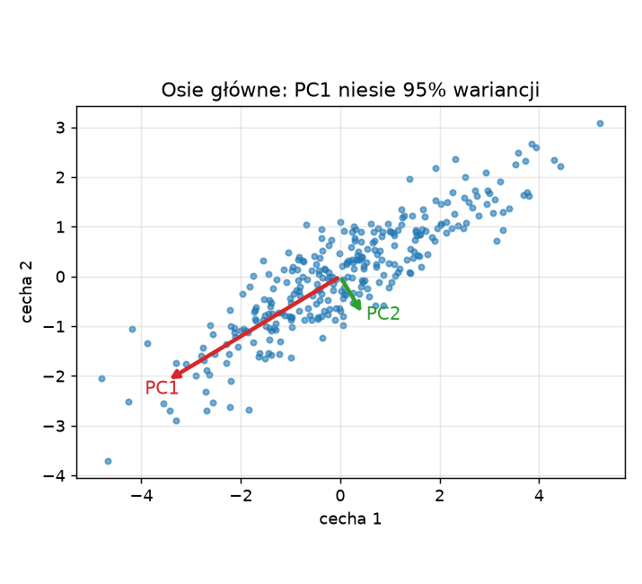

# Laboratorium 4: wprowadzenie

W poprzednich laboratoriach każdy model miał do dyspozycji zmienną docelową i można było mierzyć błąd. Tutaj etykiet nie ma. Szukamy struktury w samych cechach: grup podobnych obserwacji, kierunków największej zmienności i punktów, które nie pasują do reszty. Brak "poprawnej odpowiedzi" zmienia sposób pracy. Wynik trzeba ocenić przez pryzmat użyteczności, stabilności i zgodności z wiedzą o dziedzinie, a nie jedną metryką.

## Odległość jako podstawa

Prawie wszystkie metody tego laboratorium opierają się na odległości euklidesowej:

```
d(a, b)^2 = (a1 - b1)^2 + (a2 - b2)^2 + ... + (ap - bp)^2
```

Każda cecha wnosi do sumy swój kwadrat różnicy, więc cecha o dużej skali (wydatki rzędu tysięcy) zagłuszy cechę o małej skali. Stąd standaryzacja, czyli odjęcie średniej i podzielenie przez odchylenie standardowe, jest w skupieniach koniecznością, a nie kosmetyką. Drugim problemem są cechy silnie skośne. Wydatki klientów mają długi prawy ogon: kilku największych odbiorców potrafi wielokrotnie przekraczać medianę. Transformacja logarytmiczna `np.log1p` skraca ogon i sprawia, że odległość odzwierciedla różnice względne ("dwa razy więcej"), a nie bezwzględne.



Rysunek pokazuje to na danych, które zobaczysz w zadaniu 1. Górny wiersz to wydatki surowe, dolny po `log1p`. Skośność Delicassen spada z 11,2 do około minus 1,1.

## K-means i sylwetka

K-means dzieli dane na k skupień, minimalizując sumę kwadratów odległości punktów od centroidów swoich skupień. Algorytm (Lloyda) powtarza dwa kroki: przypisz każdy punkt do najbliższego centroidu, przelicz centroidy jako średnie. Kończy, gdy przypisania przestają się zmieniać. Wynik zależy od inicjalizacji, dlatego `KMeans` uruchamia się wielokrotnie (`n_init`) i zachowuje najlepszy przebieg. Liczbę k trzeba podać z góry. Pomagają dwie diagnostyki.

Metoda łokcia to wykres inercji (sumy kwadratów odległości) względem k. Inercja zawsze maleje, szukamy miejsca, w którym spadek wyraźnie słabnie. Na danych rzeczywistych "łokieć" często jest rozmyty.

Współczynnik sylwetki (silhouette) dla pojedynczego punktu to `(b - a) / max(a, b)`, gdzie a jest średnią odległością do własnego skupienia, a b średnią odległością do najbliższego innego skupienia. Wartości bliskie 1 oznaczają dobrze odseparowane skupienie, bliskie 0 punkt na granicy, ujemne prawdopodobny błąd przypisania. Średnia sylwetka dla całego zbioru bywa największa dla k = 2, nawet gdy biznesowo sensowniejszy jest podział drobniejszy, więc nie wolno traktować jej jako wyroczni.

Jakość skupień ocenia się też zewnętrznie, jeśli istnieje jakiś podział odniesienia. Skorygowany indeks Randa (ARI) mierzy zgodność dwóch podziałów: 1 oznacza identyczne grupy, wartość około 0 zgodność na poziomie losowym. Podział odniesienia nie musi być "prawdą", to tylko inny sposób grupowania.

## Inne podejścia do skupień

Klasteryzacja hierarchiczna (aglomeracyjna) zaczyna od pojedynczych punktów i łączy najbliższe skupienia, aż zostanie jedno. Wynikiem jest drzewo, dendrogram, które można przeciąć na dowolnej wysokości. O wyniku decyduje kryterium łączenia (linkage): `ward` minimalizuje przyrost wariancji i daje zwykle zwarte grupy, `single` łączy po najbliższych sąsiadach i łatwo tworzy "łańcuchy" oraz jedno gigantyczne skupienie.

DBSCAN opiera się na gęstości. Punkt jest rdzeniowy, jeśli w promieniu `eps` ma co najmniej `min_samples` sąsiadów. Skupienie to zbiór połączonych punktów rdzeniowych wraz z punktami brzegowymi, a punkty bez gęstego otoczenia dostają etykietę szumu (-1). Liczbę skupień algorytm wyznacza sam, ale wynik jest bardzo wrażliwy na `eps`. Przybliżony zakres `eps` odczytuje się z wykresu k-odległości, czyli posortowanych odległości do k-tego sąsiada.



Rysunek przedstawia dane syntetyczne (dwie grupy i kilka rozrzuconych punktów). Przerywane koło ma promień `eps`. Czerwone krzyżyki to szum.

Mieszanina rozkładów normalnych (GaussianMixture) modeluje dane jako sumę kilku rozkładów Gaussa, dopasowaną algorytmem EM. Daje przydziały miękkie, czyli prawdopodobieństwa przynależności, więc można wskazać klientów leżących na granicy segmentów. Liczbę składowych wybiera się kryterium informacyjnym BIC, które karze za złożoność modelu (im mniejsze, tym lepiej).

## PCA

Analiza głównych składowych (PCA) obraca układ współrzędnych tak, aby pierwsza oś (PC1) leżała w kierunku największej wariancji danych, druga (PC2) w kierunku największej wariancji prostopadłej do pierwszej, i tak dalej. Rzutując dane na kilka pierwszych osi, redukujemy wymiar, tracąc możliwie mało informacji.



Na rysunku (dane syntetyczne) strzałki wskazują dwie osie główne, a ich długość odpowiada odchyleniu standardowemu wzdłuż osi. Prawie cała zmienność leży wzdłuż PC1.

Dwa obiekty są potrzebne do interpretacji. Wyjaśniona wariancja (`explained_variance_ratio_`) mówi, jaką część całkowitej zmienności niesie każda składowa. Ładunki (`components_`) to współczynniki, z jakimi cechy wchodzą do składowej. Duży ładunek o jednym znaku dla kilku cech oznacza, że składowa opisuje ich wspólny wzrost, ładunki o przeciwnych znakach opisują przeciwstawienie. PCA jest liniowa i wrażliwa na skalę, więc wymaga tej samej standaryzacji co skupienia.

## Wizualizacja nieliniowa: t-SNE i UMAP

Gdy cech jest kilkadziesiąt, rzut liniowy na dwie osie zwykle zgniata strukturę. t-SNE szuka takiego rozmieszczenia punktów na płaszczyźnie, w którym sąsiedzi z przestrzeni wejściowej pozostają sąsiadami. Parametr `perplexity` określa w przybliżeniu, ilu sąsiadów bierze się pod uwagę: małe wartości podkreślają strukturę lokalną, duże globalną. UMAP działa podobnie, jest szybszy i zwykle lepiej zachowuje układ globalny.

Wykresy t-SNE trzeba czytać ostrożnie. Odległości między odległymi skupieniami, rozmiary skupień i ich wzajemne położenie nie mają ścisłej interpretacji, a inne ziarno losowe daje inny obraz. Metoda służy do oglądania danych i stawiania hipotez, nie do mierzenia odległości ani jako wejście do dalszych modeli bez dodatkowej kontroli.

## Wykrywanie anomalii

Anomalią jest obserwacja rzadka i różniąca się od większości, ale to, co jest "nietypowe", zależy od zadania. IsolationForest buduje losowe drzewa, które dzielą dane losowymi cięciami. Punkty odstające izolują się po kilku cięciach, więc ścieżka do nich jest krótka i taki punkt dostaje wysoki wynik anomalii. LocalOutlierFactor (LOF) porównuje lokalną gęstość wokół punktu z gęstością wokół jego sąsiadów, dzięki czemu wykrywa także punkty nietypowe względem swojego otoczenia, nawet jeśli w skali globalnej nie leżą daleko. Parametr `contamination` określa oczekiwany odsetek anomalii i wyznacza próg, dlatego warto porównywać także ciągłe wyniki, a nie tylko etykiety.

## Literatura i dokumentacja

- scikit-learn, skupienia: https://scikit-learn.org/stable/modules/clustering.html
- scikit-learn, mieszaniny rozkładów: https://scikit-learn.org/stable/modules/mixture.html
- scikit-learn, rozkład sygnału (PCA): https://scikit-learn.org/stable/modules/decomposition.html
- scikit-learn, uczenie rozmaitości (t-SNE): https://scikit-learn.org/stable/modules/manifold.html
- scikit-learn, wykrywanie nowości i anomalii: https://scikit-learn.org/stable/modules/outlier_detection.html
- Wattenberg, Viegas, Johnson, How to Use t-SNE Effectively: https://distill.pub/2016/misread-tsne/
- Dokumentacja UMAP: https://umap-learn.readthedocs.io/en/latest/
- Opis zbioru Wholesale customers (UCI): https://archive.ics.uci.edu/dataset/292/wholesale+customers
