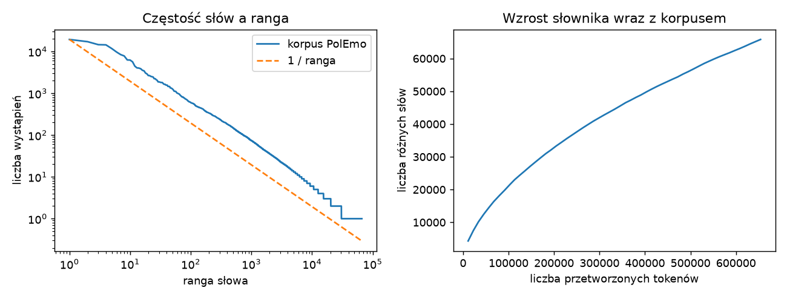
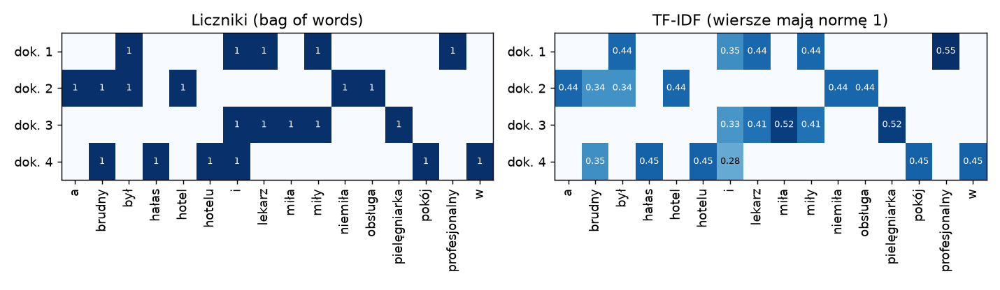
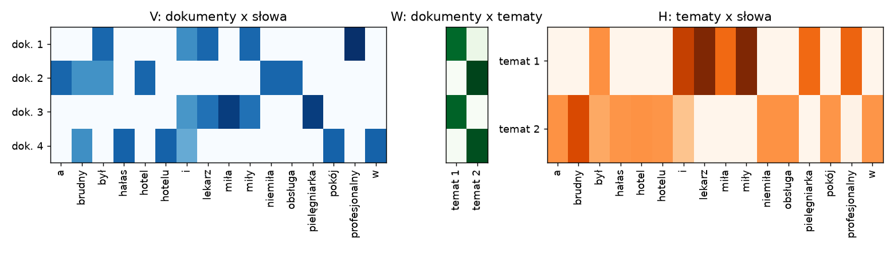

# Laboratorium 5: wprowadzenie

Algorytmy uczenia maszynowego operują na liczbach, a dokument tekstowy jest ciągiem znaków o zmiennej długości. Pierwsza część laboratorium dotyczy więc zamiany tekstu na macierz cech, a dopiero potem wykorzystania tej macierzy do klasyfikacji, wyszukiwania i odkrywania tematów.

## Korpus i słownik

Zbiór dokumentów nazywa się korpusem, a zbiór różnych słów w nim występujących słownikiem (vocabulary). Rozmiar słownika rośnie wolniej niż długość korpusu, ale nie przestaje rosnąć: w każdym nowym dokumencie trafiają się słowa, których wcześniej nie było. Częstości słów mają rozkład o bardzo długim ogonie, opisany prawem Zipfa: częstość słowa jest w przybliżeniu odwrotnie proporcjonalna do jego rangi. Na wykresie w skali logarytmicznej daje to linię zbliżoną do prostej. Konsekwencja jest praktyczna: kilkadziesiąt słów (spójniki, przyimki, "nie", "się") stanowi dużą część tekstu, a ponad połowa słownika to słowa występujące tylko raz (hapax legomena).



Język polski komplikuje sytuację. Ma bogatą fleksję, więc jedno pojęcie występuje w wielu formach ("lekarz", "lekarza", "lekarzowi", "lekarze"), a każda z nich jest dla modelu osobnym słowem. Biblioteka NLTK zawiera stemmery Snowball dla wielu języków, ale nie dla polskiego. Są dwie drogi: lematyzacja (sprowadzenie słowa do formy podstawowej, wymaga słownika morfologicznego lub modelu, np. w spaCy) albo n-gramy znakowe, które wychwytują wspólne fragmenty różnych form bez żadnej wiedzy o języku.

## Reprezentacja bag of words

W modelu worka słów (bag of words) dokument jest wektorem liczników: dla każdego słowa ze słownika zapisuje się, ile razy wystąpiło. Kolejność słów jest tracona, co zwykle mniej szkodzi, niż można by oczekiwać. Macierz dokument-term jest bardzo rzadka (w korpusie z laboratorium niezerowe są mniej niż 0,2% elementów), dlatego przechowuje się ją w formacie rzadkim (scipy.sparse). Pominięcie tego prowadzi do macierzy gęstej liczącej gigabajty.



Surowe liczniki faworyzują słowa pospolite. Ważenie TF-IDF (term frequency, inverse document frequency) mnoży częstość słowa w dokumencie przez miarę jego rzadkości w korpusie. W wersji z biblioteki scikit-learn idf słowa wynosi ln((1 + n) / (1 + df)) + 1, gdzie n to liczba dokumentów, a df liczba dokumentów zawierających słowo. Wiersze są następnie normalizowane do długości 1, dzięki czemu iloczyn skalarny dwóch wierszy jest podobieństwem kosinusowym dokumentów.

Rozmiar słownika kontroluje się parametrami wektoryzatora:

```
TfidfVectorizer(min_df=2, max_df=0.5, ngram_range=(1, 2), sublinear_tf=True)
TfidfVectorizer(analyzer="char_wb", ngram_range=(3, 5), min_df=3)
```

Parametr min_df usuwa słowa zbyt rzadkie, max_df zbyt częste (przy czym w opiniach słowo "nie" występuje w ponad trzech czwartych dokumentów, więc max_df=0.5 usuwa także nośnik negacji). Bigramy zachowują krótkie wyrażenia ("nie polecam"), a analizator char_wb tworzy n-gramy znaków wewnątrz słów, dopełnionych spacjami.

## Klasyfikacja tekstu

Przestrzeń cech jest wysokowymiarowa (dziesiątki tysięcy kolumn przy kilku tysiącach dokumentów), a klasy zwykle da się rozdzielić hiperpłaszczyzną. Dlatego modele liniowe na TF-IDF są mocnym punktem odniesienia: regresja logistyczna, liniowa maszyna wektorów nośnych (LinearSVC) i naiwny Bayes (MultinomialNB, ComplementNB). Naiwny Bayes zakłada niezależność słów w klasie i wybiera klasę o największej sumie logarytmów prawdopodobieństw słów, z wygładzaniem parametrem alpha, które chroni przed zerowymi prawdopodobieństwami.

Wektoryzator uczy się słownika i wag idf na danych, więc musi być dopasowywany wyłącznie na zbiorze treningowym. W walidacji krzyżowej wymaga to umieszczenia go w Pipeline razem z klasyfikatorem, tak aby w każdej iteracji słownik był budowany na części treningowej. Przy niezrównoważonych klasach używa się miar makro (F1 makro jest średnią F1 po klasach z równą wagą każdej).

Współczynniki modelu liniowego dają się bezpośrednio odczytać: największe dodatnie współczynniki danej klasy wskazują słowa, które za nią przemawiają. To dobre narzędzie do wykrywania artefaktów zbioru, na przykład cech, które odróżniają gatunek tekstu, a nie jego sentyment.

## Modelowanie tematów

Modelowanie tematów jest uczeniem nienadzorowanym: z macierzy dokument-term ma wyłonić grupy słów, które wspólnie występują. Rozkład nieujemny NMF (non-negative matrix factorization) przybliża macierz V iloczynem dwóch macierzy nieujemnych, V ≈ W H. Wiersze H opisują tematy jako wagi słów, a wiersze W udział tematów w dokumentach. Nieujemność powoduje, że tematy mają charakter addytywny i zwykle dobrze się je interpretuje.



LDA (latent Dirichlet allocation) jest modelem probabilistycznym: każdy dokument jest mieszaniną tematów, a każdy temat rozkładem prawdopodobieństwa po słowach. Pracuje na licznikach, nie na TF-IDF. Liczbę tematów trzeba zadać z góry. Błąd rekonstrukcji NMF maleje wraz z liczbą tematów praktycznie zawsze, a perplexity LDA na zbiorze odłożonym nie musi zgadzać się z oceną człowieka, więc wybór k opiera się na kilku źródłach i na obejrzeniu samych tematów. Jeżeli znane są prawdziwe kategorie, można je porównać z przydziałem do tematów miarami ARI (adjusted Rand index) i NMI (normalized mutual information), pamiętając, że temat nie musi pokrywać się z kategorią.

## Podobieństwo i wyszukiwanie

Dla dokumentów zapisanych jako unormowane wektory TF-IDF podobieństwo kosinusowe to iloczyn skalarny. Wyszukiwarka tekstowa przekształca zapytanie tym samym, już dopasowanym wektoryzatorem i zwraca dokumenty o największym podobieństwie. Zapytanie jest krótkie, więc wartości są niskie, a słowa spoza słownika są pomijane. Tu znów ujawnia się fleksja: forma "kardiologowi" nie występuje w korpusie, a n-gramy znakowe pozwalają dopasować dokumenty zawierające "kardiolog" lub "kardiologa".

## Embeddingi zdań

Embedding zdania to gęsty wektor (tu 384 liczby), w którym bliskie znaczeniowo teksty mają bliskie wektory. Modele z biblioteki sentence-transformers są wstępnie wytrenowane na dużych zbiorach i zwracają taki wektor bez własnego uczenia. Model paraphrase-multilingual-MiniLM-L12-v2 obsługuje m.in. polski, ale ma ograniczoną długość wejścia, a opinie z korpusu bywają dłuższe, więc dalsze słowa są obcinane. Embeddingi pozwalają zastąpić TF-IDF jako reprezentację dla tego samego klasyfikatora, a ich zaletą jest odporność na synonimy i odmianę. Za wygodę płaci się czasem obliczeń i brakiem prostej interpretacji współczynników.

## Zbiory danych

PolEmo 2.0 to polski korpus opinii konsumenckich z etykietami sentymentu, uzupełniony o neutralne fragmenty tekstów informacyjnych. W wariancie "in" (allegro/klej-polemo2-in) zbiory treningowy i testowy pochodzą z tych samych dziedzin. Zbiór pochodzi z repozytorium CLARIN-PL (https://clarin-pl.eu/dspace/handle/11321/710) i jest częścią benchmarku KLEJ. Wersja używana na laboratorium znajduje się w Hugging Face Datasets. Teksty są już podzielone na tokeny, stąd ślady typu "Była m" czy "Spędzili śmy". Opisy etykiet i uwagi o licencji znajdują się w instrukcji.

20 Newsgroups to zbiór około 18 tysięcy wiadomości z grup dyskusyjnych w języku angielskim, dostępny w scikit-learn. Przy ładowaniu usuwa się nagłówki, stopki i cytaty (remove=("headers", "footers", "quotes")), żeby model nie uczył się adresów i podpisów zamiast treści.

## Literatura i dokumentacja

- scikit-learn, ekstrakcja cech z tekstu: https://scikit-learn.org/stable/modules/feature_extraction.html
- scikit-learn, rozkłady macierzy (NMF, LDA): https://scikit-learn.org/stable/modules/decomposition.html
- scikit-learn, naiwny Bayes: https://scikit-learn.org/stable/modules/naive_bayes.html
- scikit-learn, klasteryzacja: https://scikit-learn.org/stable/modules/clustering.html
- scikit-learn, zbiór 20 Newsgroups: https://scikit-learn.org/stable/datasets/real_world.html#newsgroups-dataset
- scikit-learn, przykład klasyfikacji tekstu: https://scikit-learn.org/stable/auto_examples/text/plot_document_classification_20newsgroups.html
- scikit-learn, przykład ekstrakcji tematów NMF i LDA: https://scikit-learn.org/stable/auto_examples/applications/plot_topics_extraction_with_nmf_lda.html
- D. Jurafsky, J. H. Martin, Speech and Language Processing (3. wydanie, wersja online): https://web.stanford.edu/~jurafsky/slp3/
- Sentence-Transformers: https://www.sbert.net/
- Model paraphrase-multilingual-MiniLM-L12-v2: https://huggingface.co/sentence-transformers/paraphrase-multilingual-MiniLM-L12-v2
- spaCy, modele dla języka polskiego: https://spacy.io/models/pl
- gensim, Word2Vec: https://radimrehurek.com/gensim/models/word2vec.html
- NLTK, stemmery Snowball: https://www.nltk.org/api/nltk.stem.snowball.html
- J. Kocoń i in., Multi-Level Sentiment Analysis of PolEmo 2.0, 2019: https://aclanthology.org/K19-1092/
- P. Rybak i in., KLEJ: Comprehensive Benchmark for Polish Language Understanding, 2020: https://aclanthology.org/2020.acl-main.111/
