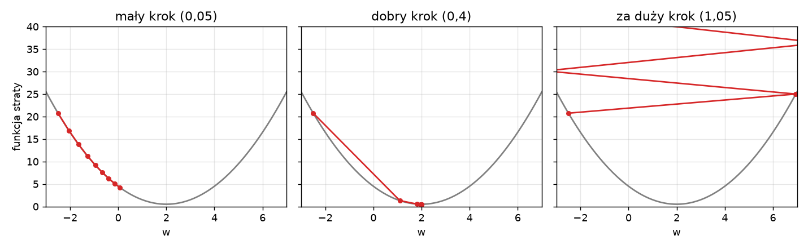
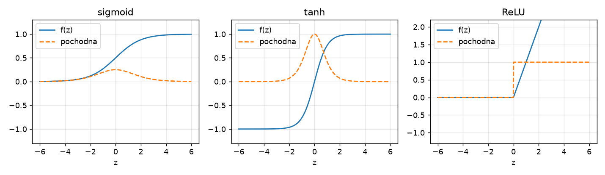
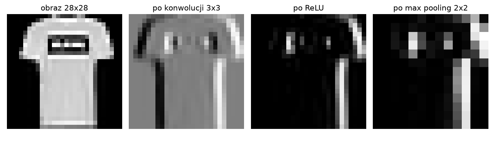

# Laboratorium 6: Sieci neuronowe. Wprowadzenie

Ten tekst zbiera pojęcia potrzebne do zadań. Nie zastępuje wykładu ani książek wymienionych na końcu, ale pozwala w kilka minut przypomnieć sobie, co robi każda linijka kodu w notebooku.

## Neuron i funkcja straty

Pojedynczy neuron liczy ważoną sumę cech i przepuszcza ją przez funkcję aktywacji:

```
z = w1*x1 + w2*x2 + ... + wn*xn + b
y_hat = f(z)
```

Dla f równego sigmoidzie wynik leży między 0 a 1 i można go czytać jako prawdopodobieństwo klasy dodatniej. Taki neuron to dokładnie regresja logistyczna, znana z wcześniejszych laboratoriów. Jakość predykcji mierzy funkcja straty (loss function). Dla klasyfikacji binarnej jest to entropia krzyżowa (cross-entropy):

```
L = -średnia( y*log(y_hat) + (1-y)*log(1-y_hat) )
```

Im pewniejsza pomyłka, tym większa kara. Dla wielu klas stosuje się wersję z funkcją softmax na wyjściu, w Keras jest to `sparse_categorical_crossentropy`, gdy etykiety są liczbami całkowitymi.

## Spadek gradientu

Uczenie polega na szukaniu wag, które minimalizują stratę. Gradient mówi, w którą stronę strata rośnie najszybciej, więc robimy krok w stronę przeciwną:

```
w := w - lr * dL/dw
```

Współczynnik uczenia (learning rate, lr) decyduje o długości kroku. Zbyt mały daje wolną zbieżność, zbyt duży powoduje skoki przez dolinę funkcji straty, a w skrajnym przypadku rozbieżność. Rysunek przedstawia ten sam kształt straty z trzema długościami kroku.



Gradient można policzyć na całym zbiorze (spadek gradientu w pełnej wersji), na jednej próbce albo na małej paczce próbek. Ostatni wariant, mini-batch, jest standardem. Jedna epoka to jedno przejście przez cały zbiór treningowy, a krok (iteracja) to jedna aktualizacja wag po jednym batchu. Przy 54 000 próbek i batchu 256 jedna epoka składa się z 211 kroków. W praktyce zamiast zwykłego SGD używa się optymalizatorów takich jak Adam, które same dopasowują długość kroku do każdej wagi.

## Funkcje aktywacji i sieć wielowarstwowa

Perceptron wielowarstwowy (MLP) układa neurony w warstwy. Warstwa ukryta przekształca wejście, a kolejna uczy się na tych przekształceniach. Bez nieliniowej aktywacji dowolna liczba warstw sprowadzałaby się do jednego przekształcenia liniowego, więc cała siła sieci bierze się z nieliniowości. Najczęściej używa się ReLU, czyli max(0, z), bo jest tania w obliczeniach i nie nasyca się dla dużych dodatnich wartości. Sigmoid i tanh nasycają się na brzegach, a ich pochodna jest tam bliska zera, co spowalnia uczenie głębokich sieci.



Gradienty dla wszystkich warstw wylicza się algorytmem propagacji wstecznej (backpropagation), który stosuje regułę łańcuchową od wyjścia do wejścia. W Keras robi to automatycznie metoda `model.fit`, ale zadanie 1 pokazuje, jak wygląda jedna taka pętla napisana ręcznie.

## Nadmierne dopasowanie i regularyzacja

Sieć z setkami tysięcy parametrów potrafi zapamiętać zbiór treningowy. Objawia się to tak: strata treningowa nadal maleje, a walidacyjna zaczyna rosnąć. Dlatego przed treningiem wydziela się zbiór walidacyjny, a zbiór testowy zostaje nietknięty do końca. Podstawowe środki zaradcze to:

* EarlyStopping, czyli przerwanie treningu, gdy strata walidacyjna przestaje się poprawiać (z opcją powrotu do najlepszych wag),
* Dropout, czyli losowe wyłączanie części neuronów w każdym kroku treningowym, aktywne tylko podczas uczenia,
* regularyzacja L2, czyli dodanie do straty kary proporcjonalnej do sumy kwadratów wag,
* więcej danych albo ich sztuczne powiększenie (augmentacja).

## Sieci konwolucyjne

Obraz spłaszczony do wektora traci informację o sąsiedztwie pikseli, a MLP musi uczyć się osobno każdego położenia cechy. Warstwa konwolucyjna (Conv2D) przesuwa po obrazie mały filtr, na przykład 3x3, i w każdym miejscu liczy ten sam iloczyn skalarny. Te same wagi działają więc w całym obrazie (współdzielenie wag), a wynikiem jest mapa cech. Warstwa MaxPooling2D zmniejsza mapę, zostawiając maksimum z małych okien, co daje pewną odporność na przesunięcia.



Efekt jest taki, że CNN ma zwykle znacznie mniej parametrów niż MLP o podobnej dokładności. Kolejne warstwy konwolucyjne budują coraz bardziej złożone cechy: krawędzie, tekstury, fragmenty obiektów. Na końcu mapy cech są spłaszczane (Flatten) lub uśredniane (GlobalAveragePooling2D) i trafiają do warstwy gęstej z softmaxem.

## Augmentacja danych

Augmentacja losowo przekształca obrazy treningowe (odbicie, niewielki obrót, powiększenie), tak aby sieć widziała za każdym razem nieco inny przykład, ale z tą samą etykietą. W Keras robią to warstwy preprocessingu (`RandomFlip`, `RandomRotation`, `RandomZoom`) umieszczone na początku modelu. Działają tylko w trybie treningowym, więc podczas `evaluate` i `predict` obraz przechodzi bez zmian. Transformacje muszą zachowywać etykietę: odbicie poziome liścia nic nie zmienia, ale odbicie cyfry 6 już tak.

## Uczenie transferowe

Sieć wytrenowana na dużym zbiorze (tutaj MobileNetV2 na ImageNet) nauczyła się cech, które przydają się także w innych zadaniach wizyjnych. Typowy przepis ma dwa kroki. Najpierw zamraża się bazę (`trainable = False`), dodaje własną głowicę klasyfikującą i trenuje tylko ją. Potem, opcjonalnie, odmraża się kilka ostatnich warstw bazy i trenuje całość z bardzo małym współczynnikiem uczenia, żeby nie zniszczyć dobrych wag. Obrazy trzeba przygotować dokładnie tak, jak robiono to przy treningu bazy, dlatego każdy model z `keras.applications` ma własną funkcję `preprocess_input`. Warstwy BatchNormalization w zamrożonej bazie wywołuje się z `training=False`, aby nie aktualizowały swoich statystyk na małym zbiorze.

## Keras 3 i backendy

Keras 3 działa na kilku backendach (TensorFlow, PyTorch, JAX). Notebooki z tego laboratorium używają wyłącznie `import keras` i nie odwołują się do `tf.*`, więc ten sam kod zadziała na każdym z nich. Wybór backendu odbywa się przed importem Keras, zmienną środowiskową `KERAS_BACKEND`. W Colabie domyślnie jest to TensorFlow. Model zapisuje się w formacie `.keras`, który przechowuje architekturę, wagi i konfigurację kompilacji w jednym pliku.

## Literatura i dokumentacja

* A. Géron, Hands-On Machine Learning with Scikit-Learn, Keras and TensorFlow, 3. wydanie, O'Reilly 2022: rozdział 10 (wprowadzenie do sieci neuronowych w Keras), 11 (trenowanie głębokich sieci), 14 (sieci konwolucyjne).
* F. Chollet, Deep Learning with Python, 2. wydanie, Manning 2021: rozdział 5 (podstawy uczenia maszynowego, nadmierne dopasowanie) i 8 (wprowadzenie do głębokiego uczenia dla obrazów).
* Keras, dokumentacja API: https://keras.io/api/
* Keras, uczenie transferowe i dostrajanie: https://keras.io/guides/transfer_learning/
* Keras, zapis i wczytywanie modeli: https://keras.io/guides/serialization_and_saving/
* Keras, warstwy augmentacji obrazów: https://keras.io/api/layers/preprocessing_layers/image_augmentation/
* Keras, EarlyStopping: https://keras.io/api/callbacks/early_stopping/
* Keras, harmonogramy współczynnika uczenia: https://keras.io/api/optimizers/learning_rate_schedules/
* Keras, MobileNetV2 i inne modele z `keras.applications`: https://keras.io/api/applications/
* Keras, zbiory danych Fashion-MNIST i CIFAR-10: https://keras.io/api/datasets/fashion_mnist/ oraz https://keras.io/api/datasets/cifar10/
